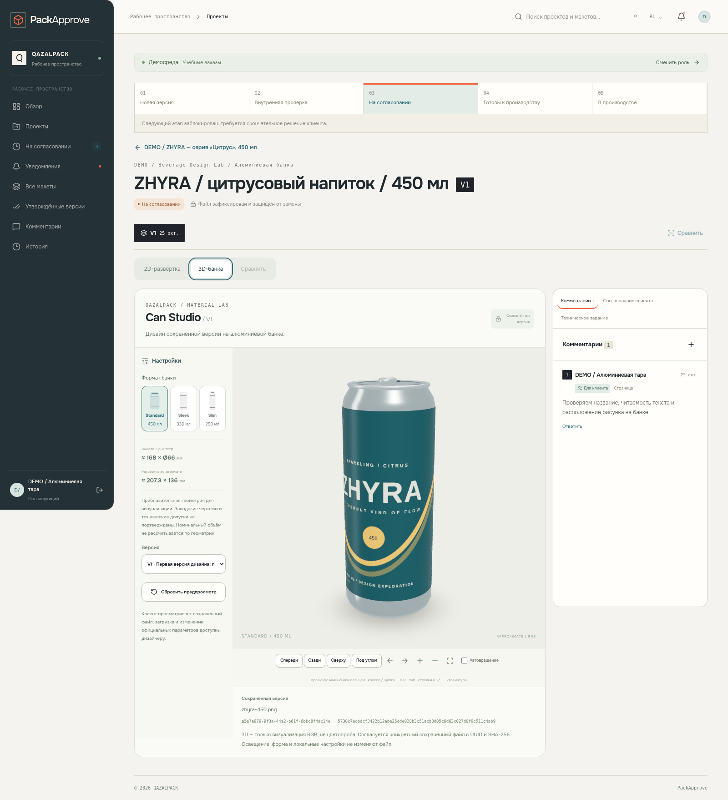
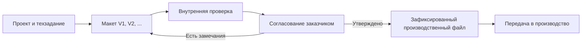
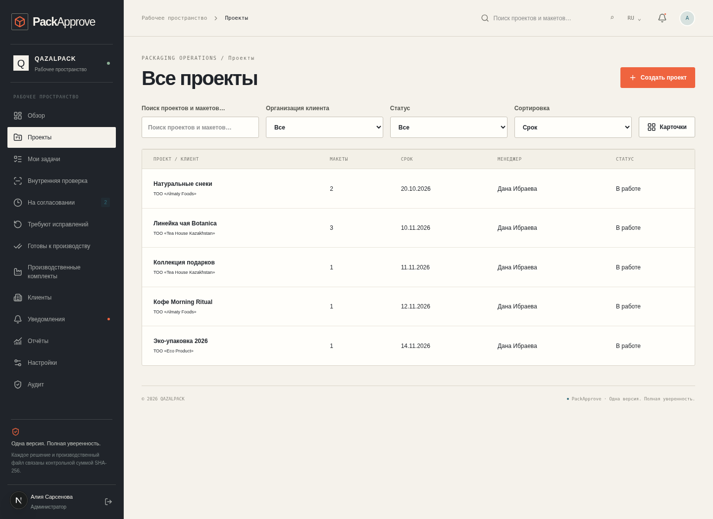
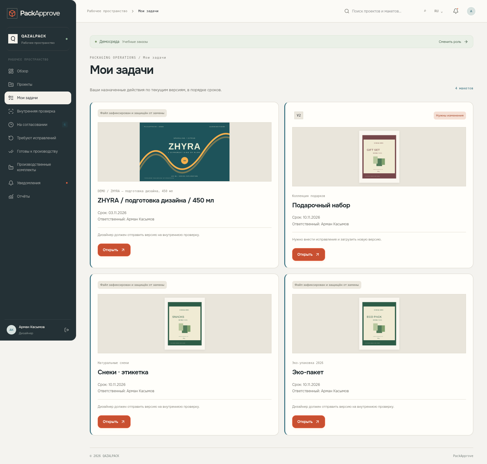
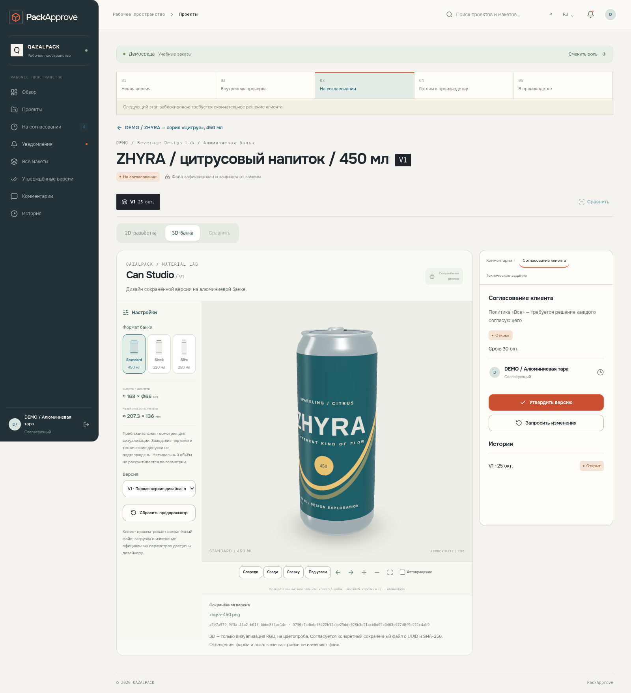

<div align="center">

# PackApprove

### От дизайна алюминиевой банки — до утверждённого файла в производстве

**Интерактивная платформа согласования упаковки с 2D/3D-просмотром, комментариями, историей версий и контролем передачи в производство.**

[**Открыть веб-приложение**](https://packapprove.vercel.app) · [**Попробовать 3D без регистрации**](https://packapprove.vercel.app/can-lab) · [**Посмотреть вращение банки**](docs/review/packapprove-3/can-rotation.webm)

</div>



> **Статус:** функциональный учебный MVP. Разработан на примере задач производителя алюминиевой тары QazAlPack. Это прототип для демонстрации идеи; официальное внедрение компанией не заявляется. Для реального производства необходимы заводские шаблоны, технологическая валидация и отдельные эксплуатационные проверки.

## Зачем нужен PackApprove?

При согласовании упаковки заказчик, дизайнер, менеджер и производственная команда часто обмениваются несколькими файлами и исправлениями. Главный риск — **в производство уходит не та версия, которую утвердил клиент**.

PackApprove объединяет цепочку в одной системе:



У каждой версии есть собственные файлы, идентификатор и контрольная сумма **SHA-256**. Решение клиента привязано к определённой версии, а не просто к имени файла.

## Возможности

- **Проекты и команда:** заказчики, сроки, задачи, роли и история действий.
- **2D/3D-просмотр:** PDF, PNG, JPEG; алюминиевая банка с вращением на 360° и сравнением версий.
- **Три формата банки:** Standard 450 мл, Sleek 330 мл и Slim 250 мл, а также экспериментальный визуальный режим.
- **Комментарии и исправления:** обсуждения с координатными метками на макете и новым раундом согласования.
- **Техническая проверка:** чек-листы перед выпуском.
- **Защита производства:** неизменяемые версии, разграничение доступа, журнал аудита и выдача точного утверждённого файла.
- **Работа на разных экранах:** интерфейсы сотрудников и клиентов, адаптация для компьютера и мобильного браузера.

### Как выглядит приложение

| Каталог проектов | 3D-макет и комментарии |
|:---:|:---:|
|  |  |
| **Кабинет дизайнера** | **Согласование заказчиком** |
|  |  |

Все изображения — скриншоты настоящего приложения на тестовых данных, полученные через браузерные проверки.

## Интерактивная Can Studio


3D-модель можно вращать, приближать, переключать ракурсы и накладывать рисунок из PNG/JPEG или выбранной страницы PDF. **Внутри проекта визуализация связана с конкретной сохранённой версией макета.**

[**Запустить открытую 3D-демонстрацию**](https://packapprove.vercel.app/can-lab) — без аккаунта и без доступа к клиентским файлам.

**Важно:** 3D-модель — предварительный визуальный мокап. Геометрия основана на приблизительных параметрах; визуализация не заменяет заводской чертёж, технический допуск или цветопробу. Юридически и технологически значимый объект согласования — зафиксированный файл версии.

## Роли пользователей

| Роль | Основные действия |
|---|---|
| **Администратор** | Организации, сотрудники, права, аудит |
| **Менеджер** | Проекты, назначения, отправка версий клиенту |
| **Дизайнер** | Загрузка макетов, новые версии, 2D/3D |
| **Допечатная подготовка** | Чек-лист и техническая проверка |
| **Клиент / согласующий** | Просмотр, комментарии, утверждение или запрос изменений |
| **Производство** | Получение утверждённого комплекта и подтверждение файла |

Веб-кабинет доступен по приглашению; для публичного знакомства без регистрации предусмотрена `/can-lab`.

## Технологии

| Уровень | Стек |
|---|---|
| Web UI | **Next.js 16**, React 19, TypeScript, Tailwind CSS, Radix UI, Onest |
| 3D | Three.js, React Three Fiber, Drei, WebGL |
| Работа с файлами | PDF.js, Supabase Storage (private), SHA-256 |
| Backend и данные | Next.js API, PostgreSQL, Supabase Auth, RLS |
| Тестирование | Vitest, Playwright |
| Развёртывание | Vercel + Supabase |

### Архитектура репозитория

```text
app/            Маршруты Next.js и API
components/     Интерфейс, формы, рабочие кабинеты, Can Studio
lib/            Бизнес-логика, доступ, загрузка и проверка файлов
supabase/       Миграции PostgreSQL и правила RLS
tests/          Unit, интеграционные и E2E-тесты
scripts/        Настройка, локальная среда и обслуживание
public/         Публичные материалы демонстрации
docs/           Архитектура, развёртывание и отчёты проверок
```

## Как попробовать

### Вариант 1 — публичная демонстрация 3D

Просто откройте [**Can Studio**](https://packapprove.vercel.app/can-lab). Регистрация, Docker и база данных не требуются.

### Вариант 2 — локальный 3D-просмотр

Требуется Node.js 22+:

```bash
git clone https://github.com/Nuli20/packapprove.git
cd packapprove
npm ci
npm run dev
```

Откройте `http://localhost:3000/can-lab`. Для этой страницы облачные ключи не нужны.

### Полное локальное рабочее пространство

Нужны PostgreSQL/Supabase Auth/Storage, Docker Compose и корректные серверные переменные окружения. На Linux/WSL2 предусмотрен следующий сценарий:

```bash
npm ci
npm run local:up
npm run dev
```

Рабочий кабинет: `http://localhost:3000`. Следуйте [полной инструкции развёртывания](docs/DEPLOYMENT.md). **Не копируйте реальные ключи в Git и не запускайте тестовый seed против production-базы.**

## Проверки

По результатам последней локальной проверки от **26 октября 2026 года**:

| Проверка | Результат |
|---|---|
| TypeScript / production build | ✅ Успешно |
| Vitest | ✅ 71 тест |
| Playwright | ✅ 24 пройдено, 2 намеренно пропущено |
| Миграции | ✅ Проверены в отдельной тестовой БД |
| Файлы и версии | ✅ В тестах проверены выбор файла и SHA-256 |

Браузерные проверки выполнены в изолированной среде. Это не независимый аудит безопасности, не проверка реального заводского оборудования и не подтверждение готовности к промышленной эксплуатации.

Подробнее: [архитектура](docs/ARCHITECTURE.md) · [3D Studio](docs/CAN-STUDIO.md) · [управление приглашениями](docs/INVITATIONS.md) · [галерея проверок](docs/review/packapprove-3/README.md).

---

<div align="center">

**PackApprove · From artwork to approved production file**

Учебный проект / Packaging design approval platform

</div>
