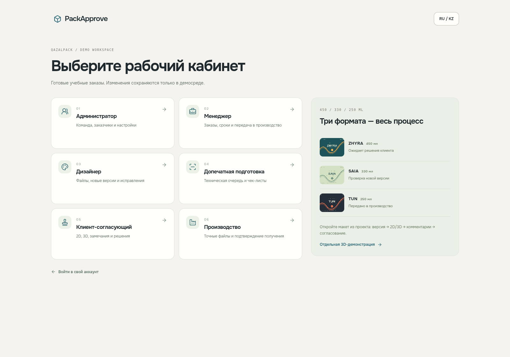

# Реальное приложение: приглашения, кабинеты и создание проекта

Снимки Playwright Chromium с production-сборки на изолированном стенде, использующем ограниченный PostgreSQL login. Это интерфейс с настоящим Supabase, а не статический макет. Данные вымышлены и отделены от production. Mobile — эмуляция iPhone в Chromium.

| Снимок | Страница |
|---|---|
| [01](01-login.png) | Авторизация |
| [02](02-demo-entry.png) | Шесть кабинетов |
| [03](03-admin.png) | Администратор |
| [04](04-manager.png) | Менеджер |
| [05](05-designer.png) | Задачи дизайнера, включая подготовленный макет банки |
| [06](06-prepress.png) | Внутренняя проверка |
| [07](07-client.png) | Ожидающие решения клиента |
| [08](08-production.png) | Производственные комплекты |
| [09](09-project-order.png) | Проект: заказчик и информация о заказе |
| [10](10-inline-client.png) | Компактная встроенная форма заказчика |
| [11](11-project-team.png) | Проект: назначение команды |
| [12](12-project-artworks.png) | Проект: макеты и сроки |
| [13](13-invitation.png) | Настоящая одноразовая ссылка, форма регистрации |
| [14](14-mobile-invitation.png) | Приглашение на телефоне |
| [15](15-version-3d-comments.png) | Версия, реальный WebGL и комментарии |
| [16](16-client-approval.png) | Клиентское согласование конкретной версии |
| [17](17-mobile-version.png) | Мобильный 3D-просмотр |
| [18](18-mobile-project.png) | Мобильное создание проекта |
| [19](19-kazakh-project.png) | Казахская локализация формы |

[Вращение сохранённой версии — WebM](version-rotation.webm) · [Manifest](manifest.json) · [Скрипт съёмки](../../../scripts/capture-onboarding-review.mjs)

Видео собрано из 22 настоящих браузерных WebGL-кадров после клавиатурных команд OrbitControls. Это не вращение статичной картинки. Номера версий, file UUID и SHA-256 относятся к сохранённым локальным demo-файлам. Решения клиента и передача в производство во время съёмки не отправлялись.

Для снимка регистрации создана настоящая отдельная demo-ссылка, затем она отозвана ротацией. Сам токен, пароли и сессии в manifest не сохраняются. Заполненная форма проекта при съёмке не отправлялась; фактическое сохранение проверяется отдельным E2E.
