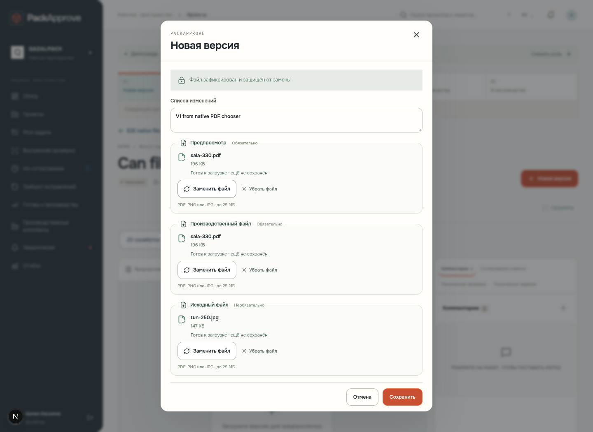

# Настоящий выбор и сохранение файлов

Снимки Playwright Chromium с работающего PackApprove и отдельного локального Supabase. Файлы вымышленных брендов выбираются через настоящий нативный filechooser. Это не стилизованные макеты. Скриншоты показывают выбранные файлы **до сохранения**; последующее сохранение V1/V2 и проверка скачанных SHA-256 подтверждены E2E и evidence JSON.

| Desktop | Mobile |
|---|---|
| [Форма версии](form-desktop.png) | [Форма версии](form-mobile.png) |
| [Выбор дизайна в 3D Studio](studio-desktop.png) | [Выбор дизайна в 3D Studio](studio-mobile.png) |
| [Проверка сохранения и хешей](evidence-desktop.json) | [Проверка сохранения и хешей](evidence-mobile.json) |

Для каждого устройства подтверждены 6 filechooser events, работа мышью/касанием/клавиатурой, замена PNG на PDF, выбранные имя/размер/статус, V1 с тремя файлами и V2 с двумя файлами, reload и точные SHA-256 всех скачанных объектов. Внутренние идентификаторы относятся только к локальным тестовым данным.

Mobile — Chromium с эмуляцией iPhone, не физическое устройство. 3D — настоящий Three.js WebGL2 через SwiftShader.
