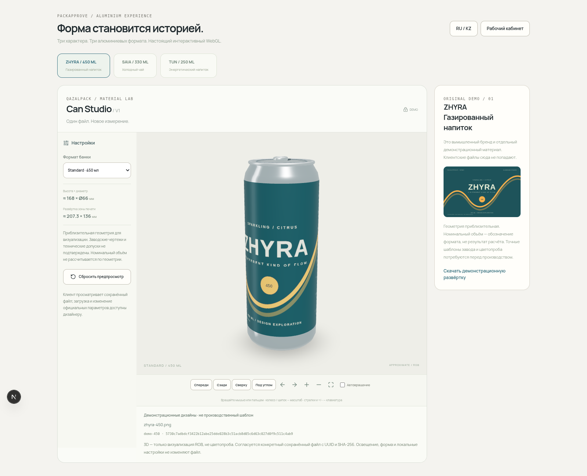

# PackApprove 3 — настоящие WebGL-снимки

PNG и видео сняты Playwright Chromium с работающего приложения. Для воспроизводимости headless-стенд использует SwiftShader: это настоящий Three.js WebGL2 renderer, а не CSS-вращение или генерация изображений. Mobile — эмуляция iPhone в Chromium, не тест физического Safari.

Ротация в WebM снята последовательными браузерными кадрами после реальных клавиатурных команд OrbitControls. PNG/JPG/PDF-оригиналы демонстрационных брендов находятся в public/can-demos; production-файлы не использовались. Исходники дизайнов — demo-files/cans.

Форматы и размеры приблизительные, без подтверждённых заводских GLB и технических допусков. RGB/PBR не заменяют цветопробу. Проверяемые номера файлов, SHA-256 и версии относятся к локальному изолированному стенду.

Список снимков, время и фактические ошибки браузера — в manifest.json. При съёмке клиентские решения не отправлялись.

## Посмотреть

[Короткое вращение 360° — WebM](can-rotation.webm) · [Manifest](manifest.json)

| Снимок | Что проверено |
|---|---|
| [Авторизация](01-login.png) | Новый алюминиевый визуальный акцент |
| [Standard 450 / PNG](02-standard-450.png) | Реальный дизайн на печатной поверхности |
| [Металлическая крышка](03-metal-lid.png) | Отдельная непечатная геометрия |
| [Sleek 330 / PDF](04-sleek-330-pdf.png) | Первая страница PDF на банке |
| [Вторая страница PDF](05-pdf-page-2.png) | Замена растра без перезагрузки страницы |
| [Slim 250 / JPG](06-slim-250.png) | Третий формат и JPEG |
| [Дашборд](07-dashboard.png) | Отдельный demo-проект с реальными сохранёнными версиями |
| [Приватный макет](08-private-version.png) | Настоящий авторизованный кабинет, версия/файл/SHA |
| [Согласование клиентом](09-client-approval.png) | 3D и действующая панель решений |
| [Mobile Studio](10-mobile-studio.png) | Модель в центре мобильного экрана |
| [Mobile приватный макет](11-mobile-private.png) | Клиентский просмотр сохранённой версии |
| [Fallback 2D](12-fallback-2d.png) | Реальная развёртка при отсутствии WebGL |

При съёмке — **0 page errors**. Скрипт: [capture-can-review.mjs](../../../scripts/capture-can-review.mjs). Он только читает локальные demo-проекты; входы в demo-аккаунты не публикуют решения.
