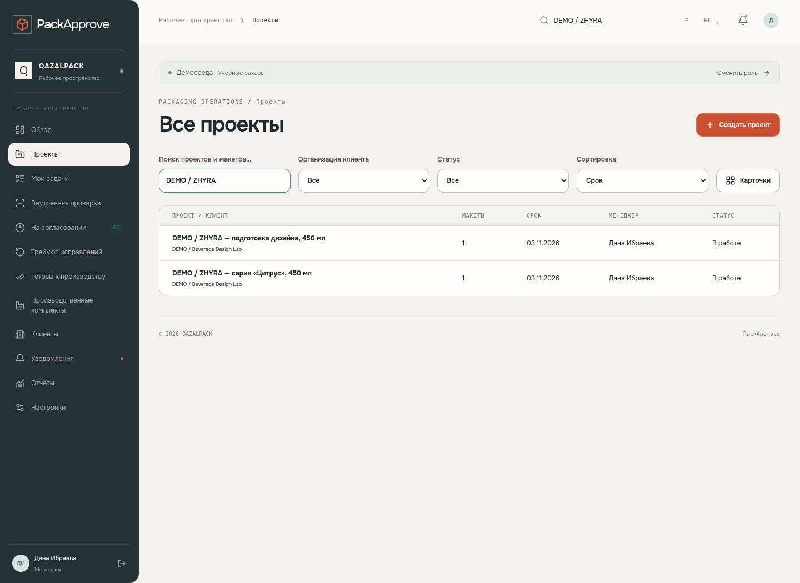
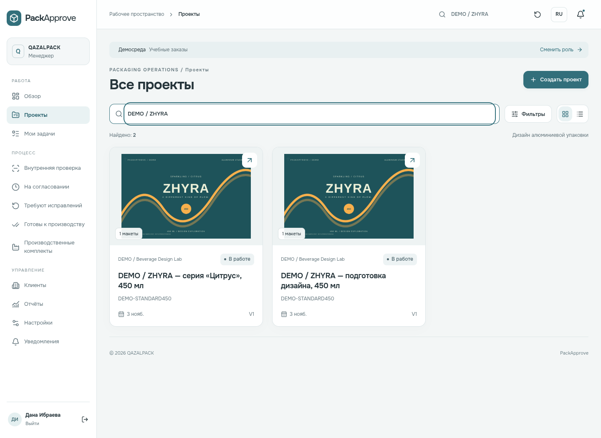
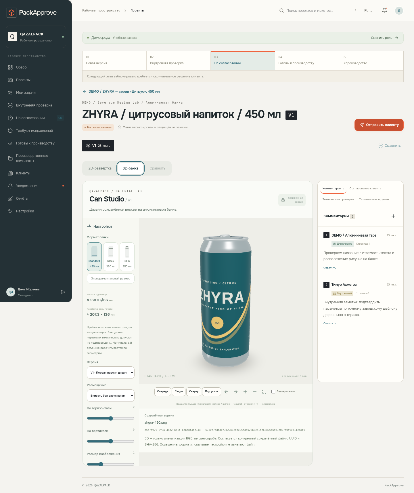
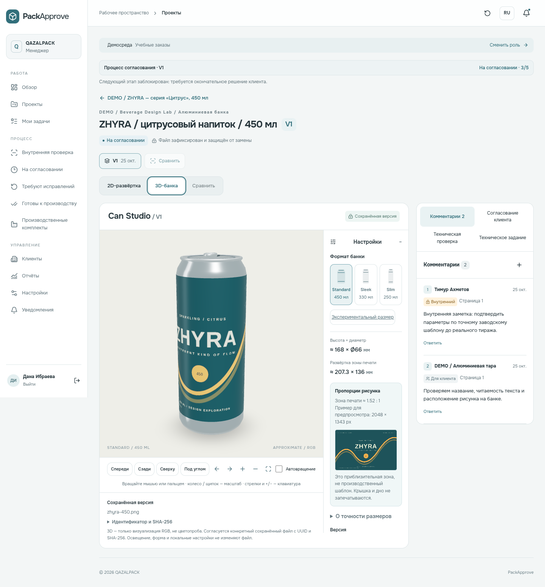
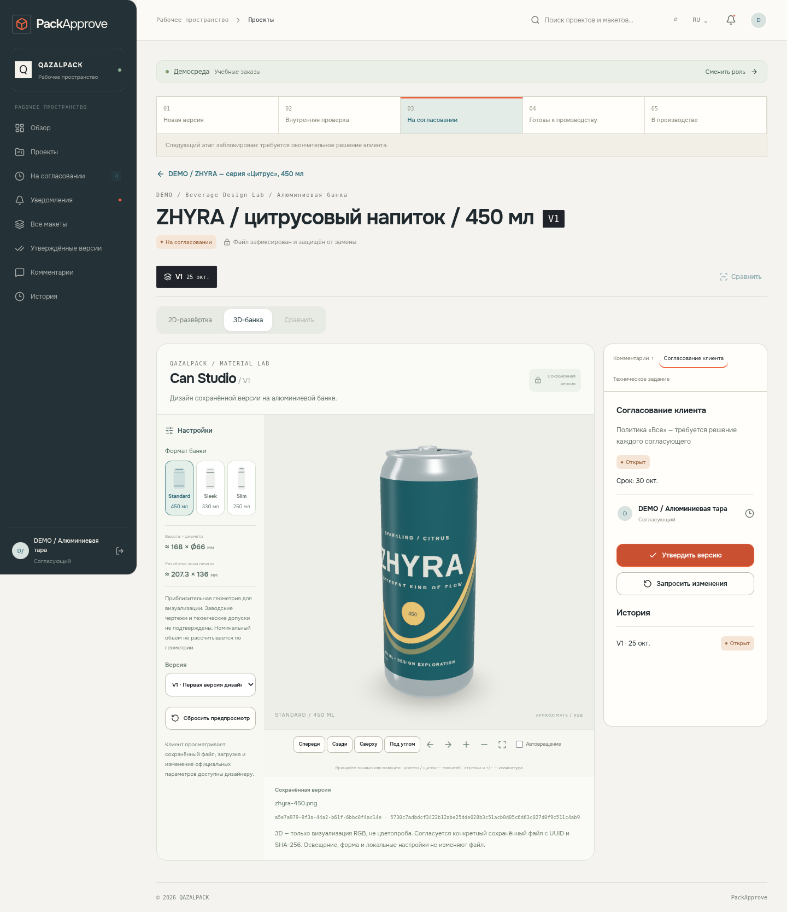
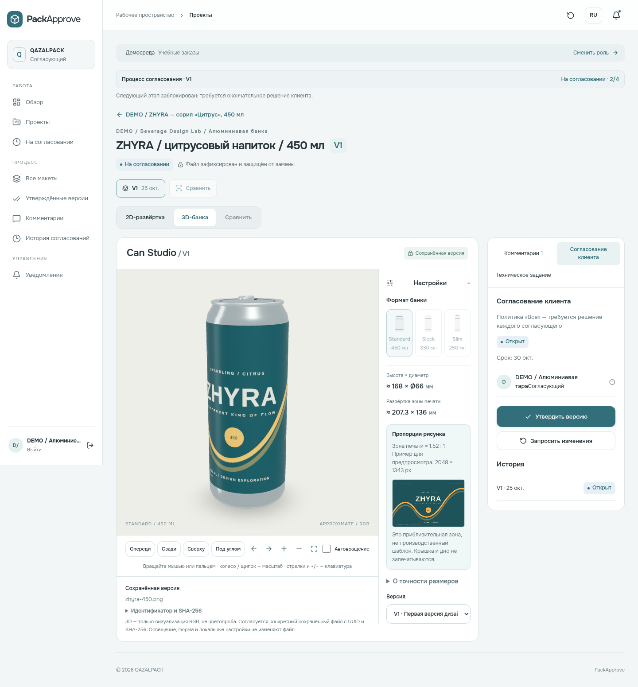
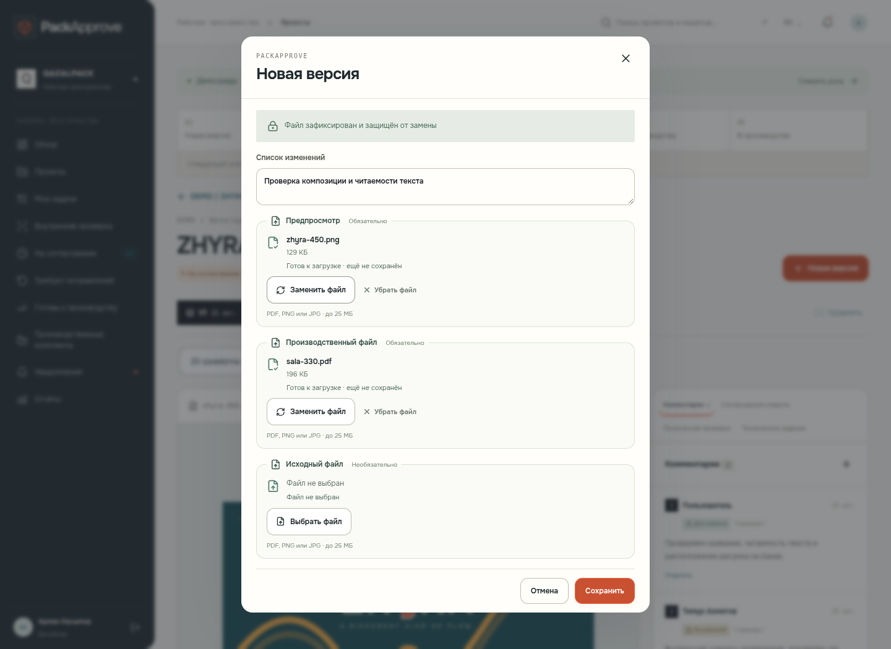
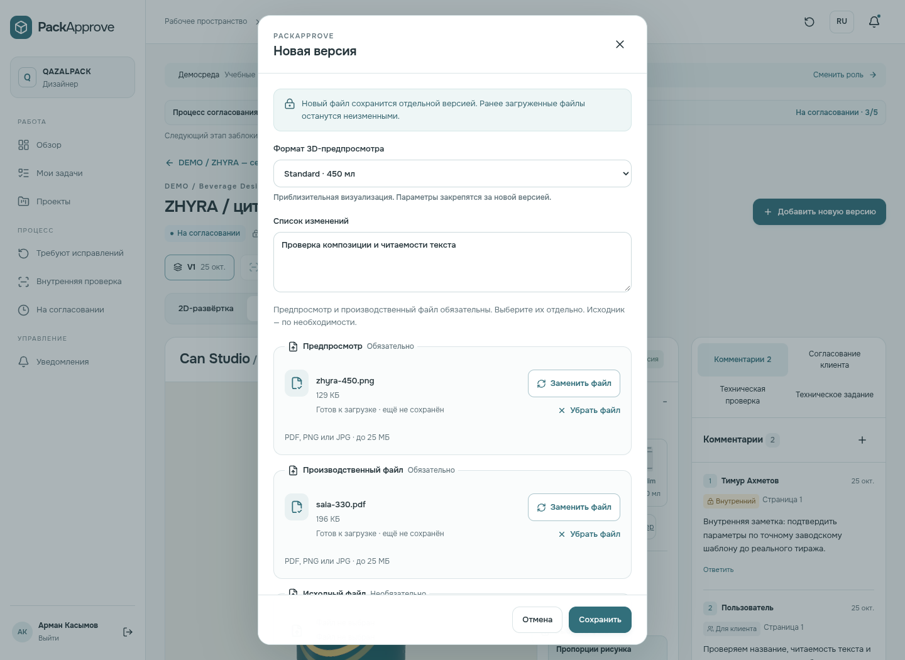

# Product quality pass — проверенные материалы

Основа: `e7cc0978d082d7fa13cec1586d1f76bc7eade974` (`origin/main`, повторно проверен 26.10.2026). Ветка `feat/product-quality-pass`. Финальная сборка приложения: `4d98ce81f34dd90931f1df4e80f986bb5e6baa63`; полный E2E-прогон 50 случаев — интерфейс `0aeab273c0245a2cba0ab8791a14ab11082f8201`; затем отдельно перепроверены comparison, studio navigation и 3D после исправления URL (9 passed, 1 прежний skip). Последняя серверная правка усиливает общий runtime/CLI role check и проверена scratch role-тестами.

[Запись сценария, MP4 · 24 секунды](workflow-demo.mp4) · [Порядок выпуска и отката](../../PRODUCT-QUALITY-RELEASE.md) · [Контрольные суммы материалов](manifest.json)

Это реальные browser screenshots и видеокадры, без генерации изображений. Снимки сделаны из production-сборок **локального** приложения; все организации, файлы и аккаунты в материалах — изолированные демонстрационные/тестовые. Показанная демопанель недоступна с удалённым backend. Production и main не обновлялись. Видеоролик соединяет два фрагмента одной успешно завершённой UI-проверки: дизайнер (загрузка/вращение) и клиент (решение); промежуточная работа менеджера/допечатника вырезана. Пропорции изображения не менялись, кадры приложения не дорисовывались.

## Экраны до/после

### Проекты

| До · main | После · quality branch |
|---|---|
|  |  |

### Макет с настоящей 3D-банкой

| До · main | После · quality branch |
|---|---|
|  |  |

### Согласование клиента

| До · main | После · quality branch |
|---|---|
|  |  |

### Форма загрузки с выбранными файлами

| До · main | После · quality branch |
|---|---|
|  |  |

## Телефон и планшет

| Экран | 390 px до | 390 px после | 768 px до | 768 px после |
|---|---|---|---|---|
| Проекты | [Открыть](before/projects-390.png) | [Открыть](after/projects-390.png) | [Открыть](before/projects-768.png) | [Открыть](after/projects-768.png) |
| Макет / 3D | [Открыть](before/studio-390.png) | [Открыть](after/studio-390.png) | [Открыть](before/studio-768.png) | [Открыть](after/studio-768.png) |
| Клиент | [Открыть](before/client-390.png) | [Открыть](after/client-390.png) | [Открыть](before/client-768.png) | [Открыть](after/client-768.png) |
| Загрузка | [Открыть](before/upload-390.png) | [Открыть](after/upload-390.png) | — | — |

В [evidence после](after/evidence.json) зафиксированы отсутствие pageerror и равенство viewport/document width: 1440, 768 и 390 px. Дополнительно E2E проверяет все разделы семи ролей на desktop/mobile. Chromium 154.0.8037.57, Linux, SwiftShader; desktop 1440×1050/DPR1, tablet 768×1050/DPR1; mobile viewport 390×664, screen 390×844/DPR3, preset iPhone 13 в **Chromium**. Это не проверка Safari или физического iPhone.

## Производительность

Один компьютер и один Supabase PostgreSQL 17.6/Auth/Storage на localhost, production builds, сеть и CPU без троттлинга. До и после использованы одинаковые бизнес-данные: **244 проекта, 283 макета, 284 версии**. Хеш списка их UUID: `8ef8aad97f3c6e680828ded7d4f9bafe7977a3442f26fca0e553013896b5a180`. Новые тестовые записи создавались до замеров, между сравниваемыми прогонами бизнес-данные не менялись. Обычные чтения файлов регистрируют access/download events; они могут менять небольшой хвост legacy snapshot. Auth/Storage/OS caches не сбрасывались.

Медиана трёх прогонов на ширину; новый browser context на каждый прогон, серверный процесс warm. API warm — медиана трёх повторов внутри каждого прогона, затем медиана трёх прогонов. JSON — размер распакованного UTF-8 payload; JS/CSS — encodedBodySize ресурсов, полученных при открытии обзора. LCP/CLS записаны после networkidle перед взаимодействием; это лабораторное наблюдение, не полевой Core Web Vitals. INP не измерялся. На desktop ленивые PDF-миниатюры попадают в viewport раньше, поэтому JS отличается от мобильной выборки. Three.js не включён в начальные запросы обзора.

| Ширина | Показатель | До | После |
|---|---|---|---|
| 1440 | API обзора, warm | 951 мс | 137 мс |
| 1440 | Кабинет готов | 1464 мс | 334 мс |
| 1440 | Каталог готов | 1429 мс | 278 мс |
| 1440 | Проект готов | 1369 мс | 210 мс |
| 1440 | Рабочая область макета | 1366 мс | 871 мс |
| 1440 | PDF нарисован | 1737 мс | 1289 мс |
| 1440 | Первая активация 3D | 888 мс | 896 мс |
| 1440 | JSON обзора | 1855.6 КБ | 23.6 КБ |
| 1440 | JSON каталога | 1855.6 КБ | 37.3 КБ |
| 1440 | JS обзора, передано | 370.3 КБ | 307.4 КБ |
| 1440 | CSS обзора, передано | 21.8 КБ | 14.0 КБ |
| 1440 | TTFB | 6 мс | 3 мс |
| 1440 | FCP | 88 мс | 64 мс |
| 1440 | LCP после networkidle | 1452 мс | 516 мс |
| 1440 | CLS после networkidle | 0.0002 | 0.0009 |
| 390 | API обзора, warm | 951 мс | 129 мс |
| 390 | Кабинет готов | 1453 мс | 303 мс |
| 390 | Каталог готов | 1402 мс | 148 мс |
| 390 | Проект готов | 1361 мс | 144 мс |
| 390 | Рабочая область макета | 1345 мс | 846 мс |
| 390 | PDF нарисован | 1732 мс | 1187 мс |
| 390 | Первая активация 3D | 884 мс | 974 мс |
| 390 | JSON обзора | 1855.6 КБ | 23.6 КБ |
| 390 | JSON каталога | 1855.6 КБ | 37.3 КБ |
| 390 | JS обзора, передано | 370.3 КБ | 171.7 КБ |
| 390 | CSS обзора, передано | 21.8 КБ | 14.0 КБ |
| 390 | TTFB | 13 мс | 2 мс |
| 390 | FCP | 92 мс | 60 мс |
| 390 | LCP после networkidle | 1300 мс | 328 мс |
| 390 | CLS после networkidle | 0.0000 | 0.0000 |

Отдельно: новый серверный процесс, первый API после health/login — **970 мс → 171 мс**, медиана трёх независимых процессов. БД/OS остаются warm; это не Vercel cold-start. RLS transaction wall time (SQL round trips + materialization, без HTTP/Auth/JSON serialization), три warm samples — **876 мс → 95 мс**. Ни один запрос не вынесен из `asUser`/`SET LOCAL ROLE`. Объём данных и загрузка каталога улучшились; мобильная первая активация 3D в этой выборке немного медленнее. Значения локальные и не прогнозируют production latency/нагрузку.

Сырые измерения: [before](measurements/before.json), [after](measurements/after.json), [cold before](measurements/cold-before.json), [cold after](measurements/cold-after.json), [RLS SQL](measurements/sql.json). Воспроизведение: `node scripts/quality-benchmark.mjs --origin=http://127.0.0.1:3030 --out=.data/measurement`; cold/SQL scripts находятся рядом. Для сравнения main запускают в отдельном worktree на той же локальной фикстуре; скрипты отказываются обращаться к удалённому backend.

## Проверки

| Команда / сценарий | Результат |
|---|---|
| `npm run typecheck` | Пройдено |
| `npm run build` | Пройдено, Next.js 16.4.3 |
| `npm test` | 95 проверок, 17 файлов, без ошибок |
| `npm run db:doctor` / `npm run db:plan` | 4 миграции, 787 объектов соответствуют контрактам; диагностика read-only |
| `npm run db:test-migrations` | Чистая установка; RLS/ACL; ограниченный LOGIN; наследуемый BYPASS/ownership; upgrade с сохранением записей; actor_id drift; частичная схема — пройдено на scratch DB |
| Playwright, полный прогон 50 случаев | 48 passed, 2 skipped, без ошибок |
| После исправления comparison URL: сравнение + 3D + Back/Forward, desktop/mobile | 9 passed, 1 прежний skip; включает 2 новых случая. Всего проверено 50 уникальных E2E случаев, 2 дубликата пропущены |
| Настоящий native filechooser | 7 событий в сценарии; click/tap/Enter/Space, PNG/PDF/JPG, замена, валидация, V1/V2, SHA/private Storage, reload — пройдено |
| Полный UI цикл, desktop/mobile | Новый клиент → реальные одноразовые приглашения/регистрация → проект/независимый макет → V1 → review → замечание → V2 → review/approval → точные байты → receipt → revoke — пройдено |
| Защита версии | Старая вкладка получает 409 и открывает актуальную; дизайнер/наблюдатель не утверждают; клиент без технической готовности не выпускает; «Все» требует всех; файл не заменяется — пройдено |
| Сессии | Refresh-only cookie, истечение, logout во второй вкладке, RU/KZ, формы, Back/Forward — пройдено |
| PDF / 3D | Zoom без повторного скачивания, три формата/PNG/PDF/JPG, camera/zoom/keyboard, переключение версий, WebGL fallback и readonly клиента — пройдено |

Полный прогон: `PLAYWRIGHT_BROWSERS_PATH=/tmp/quality-playwright PACKAPPROVE_TEST_ORIGIN=http://127.0.0.1:3030 npm run test:e2e -- --output=.data/playwright-checked --reporter=list`. В этой среде Playwright FFmpeg использует установленный `/usr/bin/ffmpeg` через локальный cache path, поскольку скачивание с CDN было недоступно. В CI устанавливаются штатные Chromium/FFmpeg командой Playwright. Runtime создаётся `npm run test:serve-restricted -- --port 3030`: LOGIN NOINHERIT без прямого доступа к invitations; финальная проверка общей функцией подтверждает safe=true, отсутствие owner/BYPASS и возможности SET ROLE в повышенные роли. Owner используется только для изолированных seed/migration инструментов, не для проверенного веб-сервера.

Два пропуска существовали до изменений: повтор backend mutation в мобильном `can-studio.spec.ts` и повтор большого upload в `large-private-upload.spec.ts`; desktop покрывает их HTTP/Storage-логику. Мобильный новый UI цикл отдельно выполняет настоящую загрузку и производство, а WebGL и chooser также проверяются на mobile. Пропуски не скрывают новые падения.

Пустой справочник отдельно проверен UI fixture с отфильтрованными сотрудниками; полный сценарий нового клиента/приглашения/проекта работает с настоящими записями локального PostgreSQL/Auth. Чистая схема проверяется scratch migrations. Это не утверждение о полном onboarding на пустом внешнем Supabase. Доставка recovery email через внешний SMTP и внешняя staging/production конфигурация не проверены; локальный recovery provider/capability/role preservation покрыт тестами.

## Ревью diff

- Scoped queries остаются в одной RLS-транзакции; UUID проекта/версии проверяются сервером. Клиент не получает внутренние threads/replies и staff setup/audit. Files проверяются отдельно, production получает bytes только через действующий package endpoint.
- Решения/файлы/пакеты связаны с точной immutable версией и SHA; guard triggers/уникальные ограничения сохраняются. Отзыв и optimistic locking не заменены UI-бейджами. Повтор запроса проверяет текущую роль до idempotency response.
- Кеш приватных метаданных — per cabinet, URL + свежая идентичность/роль/row_version, TTL 15 секунд; очищается при logout/login, смене профиля и 403/404. Общего межпользовательского server cache нет; файлы/cookies/tokens не записываются в localStorage.
- PDF load зависит от URL, render — от page/zoom; RenderTask отменяется, document destroy вызывается. Thumbnail scheduler ограничивает обработку двумя PDF, освобождает slot при render/abort. Three.js остаётся dynamic import; texture/material/geometry/renderer disposal и DPR limit сохранены. Физическая GPU-память не измерялась.
- Четыре SQL migration файла и package-lock не изменены. Doctor/repair сравнивают полные контракты; ошибочные/частичные схемы не помечаются применёнными. Новая миграция не нужна. Автоматического применения к production нет.
- Credential-pattern scan текущих tracked файлов не нашёл живых токенов/ключей; tracked/history filenames содержат только `.env.example`. `.env.local`, compose credentials, traces и сырые приглашения исключены из публикации. Локальные fixture пароли явно отделены от production. Это проверка diff/дерева, не доказательство отсутствия неизвестных исторических утечек.
- Удалён только `app/studio-refinements.css` (996 строк): он уже не импортировался, каскад сведён в globals и проверен по ролям/мобильным состояниям. Миграции, тесты, lockfile, PDF worker/font assets и старые README images сохранены.

Ограничения и внешний порядок проверки — в [release runbook](../../PRODUCT-QUALITY-RELEASE.md). CI добавлен без production-секретов; результат внешнего GitHub Actions/Preview не выдаётся за локальную проверку.
