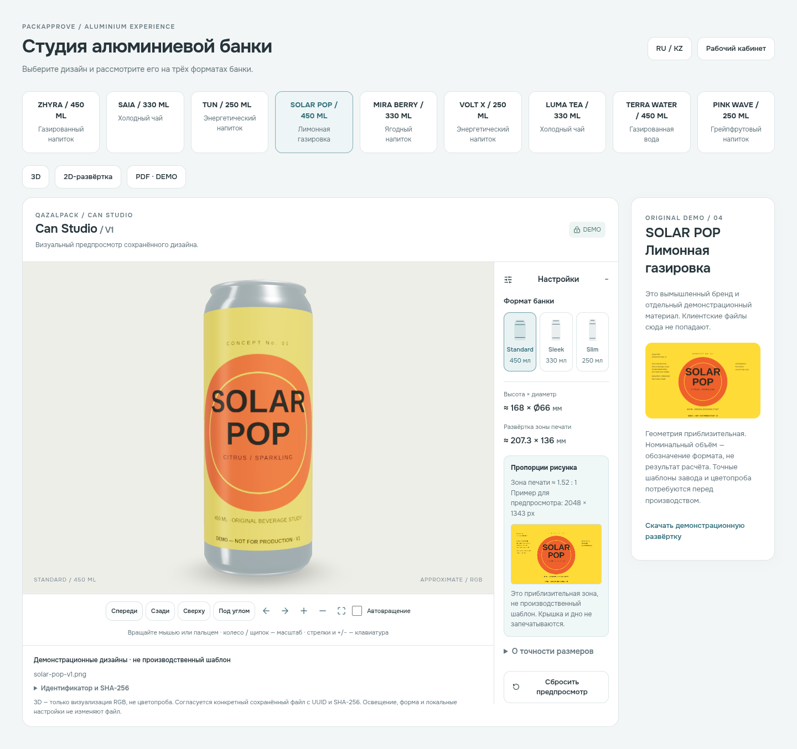
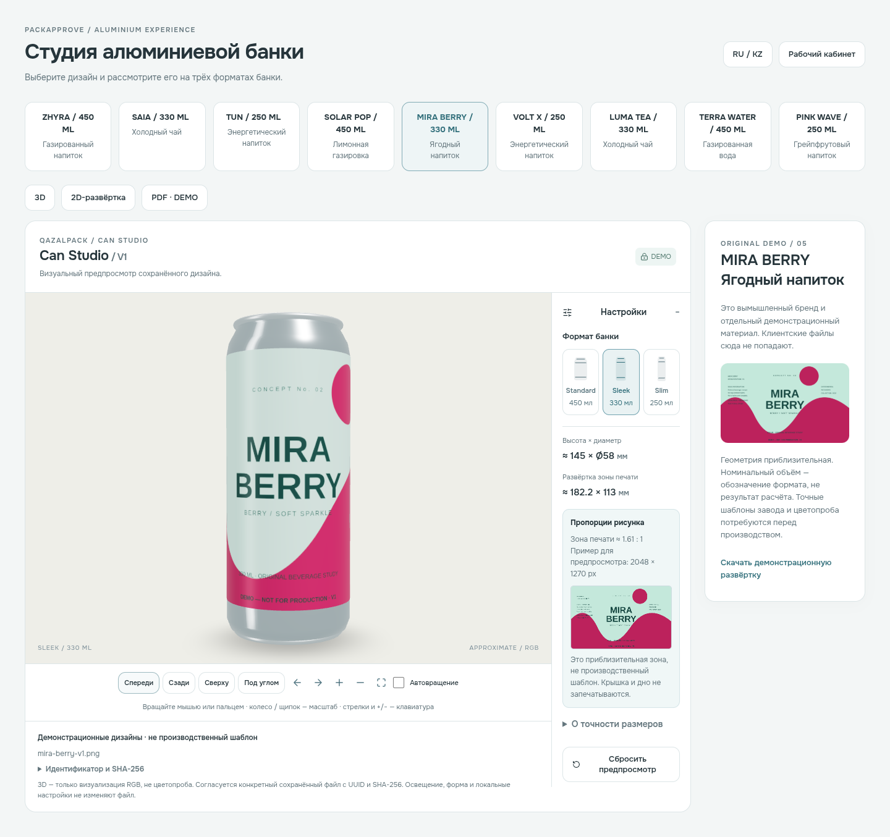
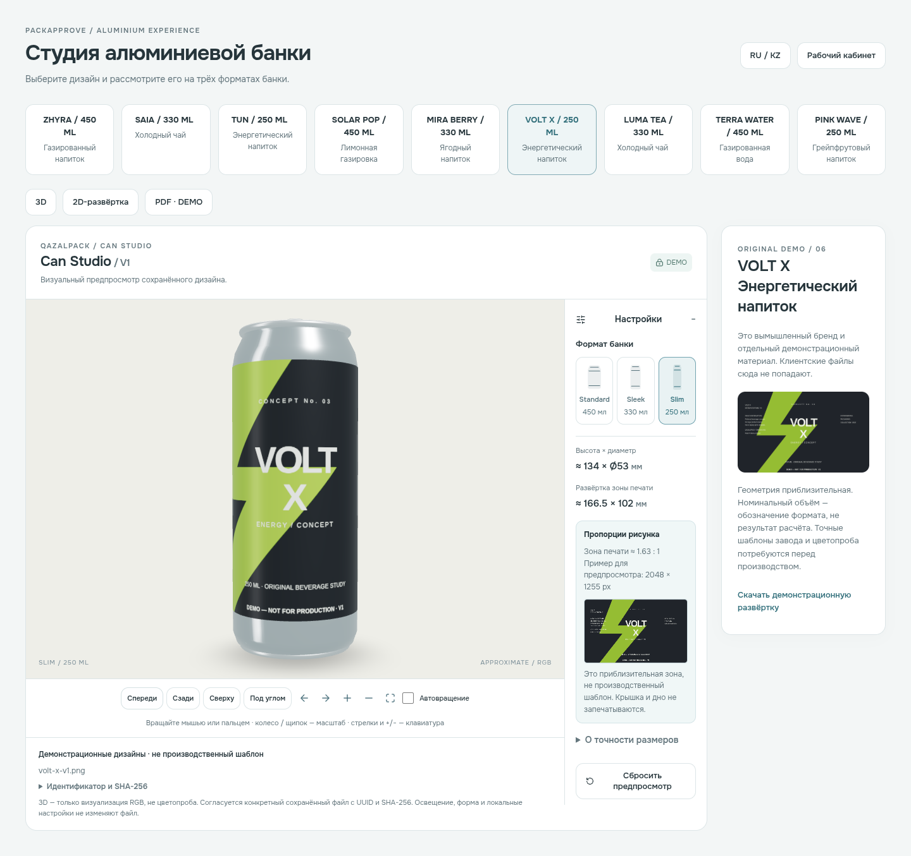
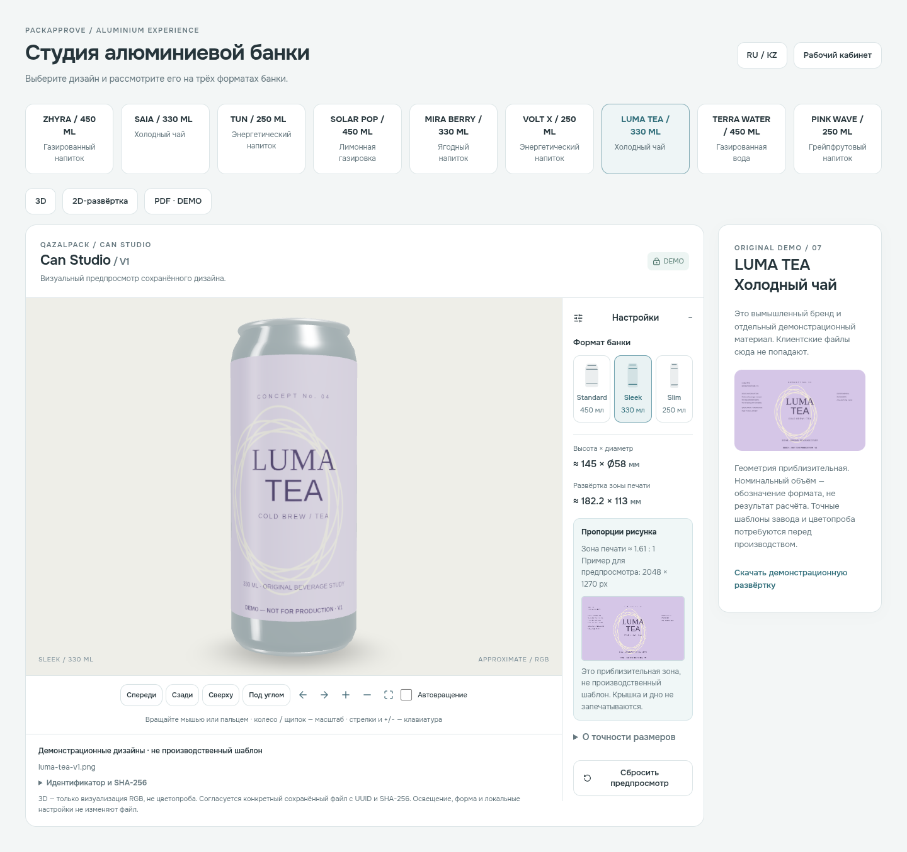
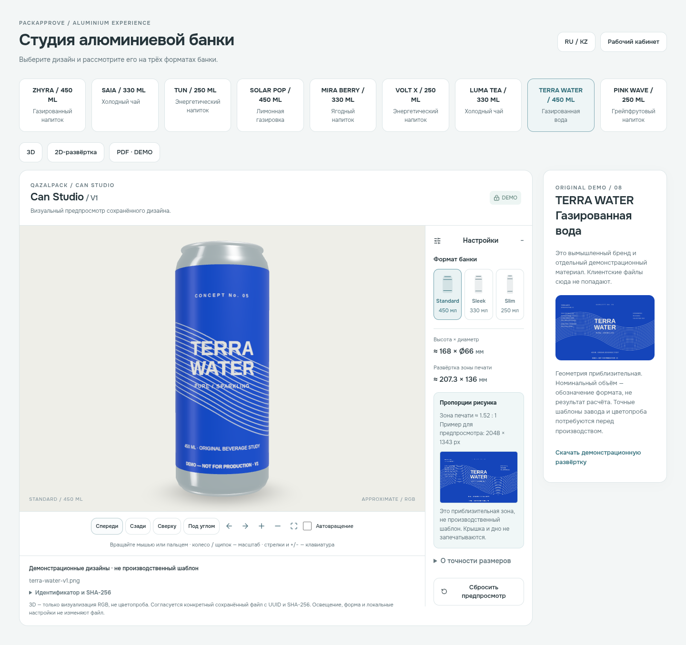
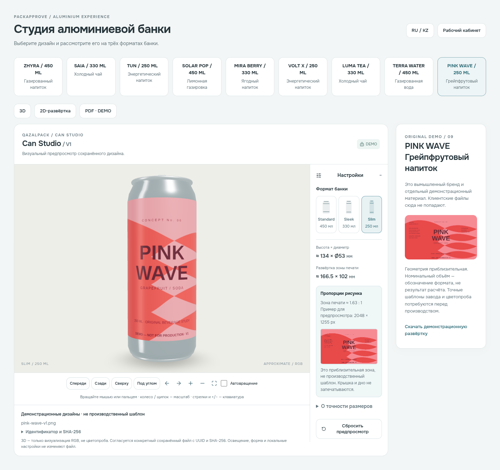

# Настоящие скриншоты WebGL

Снято Playwright Chromium на локальном приложении. Публичные оригинальные DEMO-материалы; приватные данные клиентов не использованы.

## SOLAR POP

[Desktop](desktop-solar-pop.png) · [Mobile](mobile-solar-pop.png)

## MIRA BERRY

[Desktop](desktop-mira-berry.png) · [Mobile](mobile-mira-berry.png)

## VOLT X

[Desktop](desktop-volt-x.png) · [Mobile](mobile-volt-x.png)

## LUMA TEA

[Desktop](desktop-luma-tea.png) · [Mobile](mobile-luma-tea.png)

## TERRA WATER

[Desktop](desktop-terra-water.png) · [Mobile](mobile-terra-water.png)

## PINK WAVE

[Desktop](desktop-pink-wave.png) · [Mobile](mobile-pink-wave.png)

## Рабочий кабинет

[Каталог с реальными проектами](catalog.png) · [Приглашённый клиент: утверждённая TERRA WATER V2](client-terra.png)
